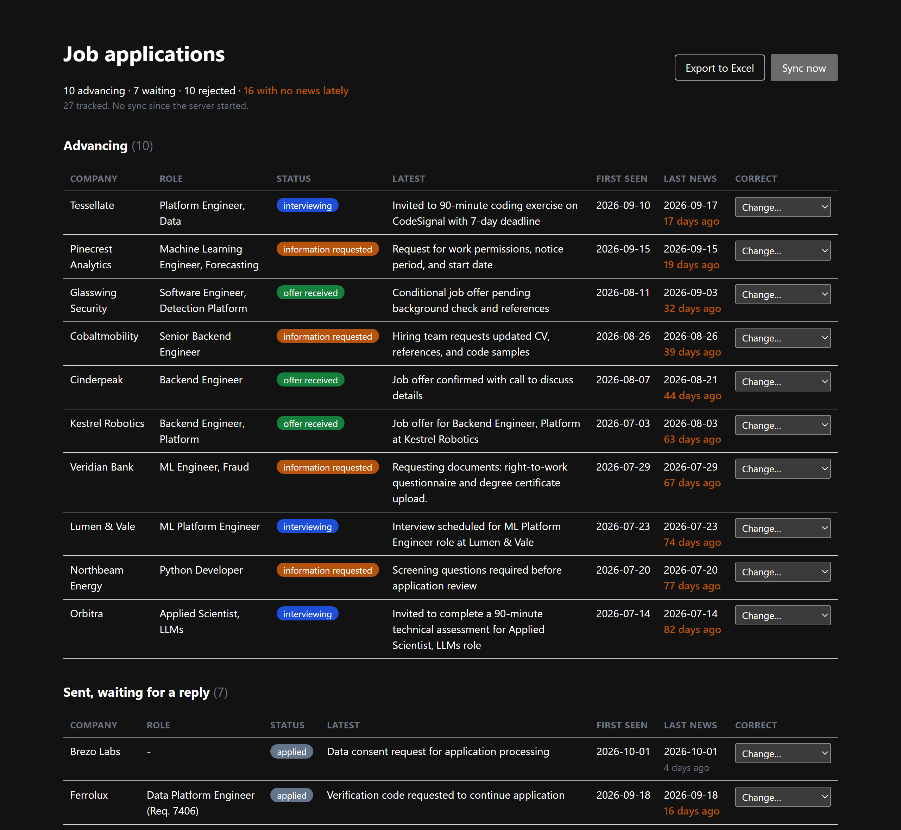
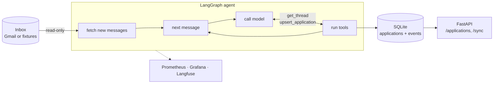
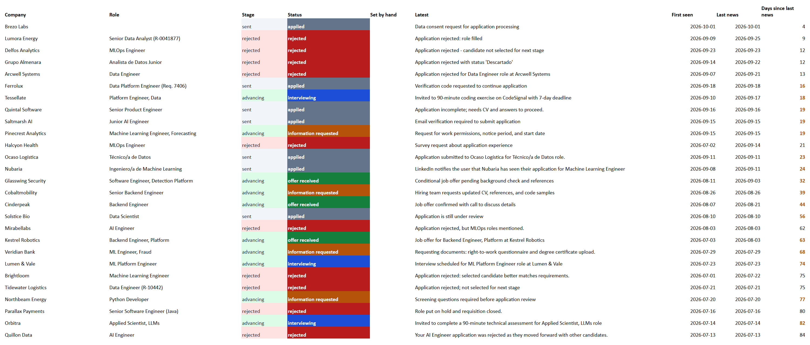

# apply-agent

An LLM agent that keeps track of job applications by reading an email inbox,
**read-only**. It classifies replies (rejection, interview invitation, request
for information, offer, other), extracts company / role / date / summary, and keeps a
table of applications and their current status.

[](https://github.com/jbsanchezr/apply-agent/actions/workflows/ci.yml)

[](LICENSE)

**Stack:** LangGraph · Claude or a local model via Ollama · FastAPI ·
SQLAlchemy · Prometheus · Grafana · Langfuse · Docker · GitHub Actions



*The page after syncing the bundled synthetic inbox with a local `qwen3:8b`.
Every company and email in this repository is invented.*

## Highlights

* **Runs with zero credentials.** Out of the box it reads bundled synthetic
  emails and uses a keyword baseline, so `docker compose up` works on any
  machine. A free local LLM (Ollama) or Claude is one environment variable away.
* **Measured, not assumed.** An evaluation harness runs the *whole agent* over
  48 labelled emails, including LinkedIn, InfoJobs, Indeed, Workday, Greenhouse
  and Lever notifications in English and Spanish, and reports per-class
  precision/recall, confidence intervals and a confusion matrix. The local
  `qwen3:8b` model goes from the baseline's 70% accuracy to 96% (with an honest
  caveat, below).
* **Tested on a real inbox, and changed by it.** The first sync of a real
  mailbox (424 emails, 82 applications) found what 97% on synthetic fixtures
  had not: a model that hung for half an hour, Gmail's per-minute quota, and
  six applications marked as advancing that were all surveys, email
  confirmations and other housekeeping. Each became a fixture, a fix and a
  written decision (D47-D53).
* **The user has the last word.** A status can be corrected by hand without
  freezing the application, duplicate rows can be merged and the merge is
  remembered, and the table exports to a colour-coded Excel workbook.
* **Read-only by design.** The Gmail integration asks only for
  `gmail.readonly`, rejects broader tokens, and exposes a read-only interface.
  Email bodies are never stored or logged.
* **Contained against prompt injection.** The model gets only two tools, both
  bound to the email being processed, so a malicious email can at worst get
  itself misclassified.
* **Observable.** Prometheus metrics (tokens, cost, latency, outcomes), a
  19-panel Grafana dashboard that is tested against the code, and optional
  Langfuse traces.
* **Reproducible CI for free.** LLM responses are recorded once and replayed,
  so CI re-runs the LLM evaluation on every push without a GPU or API key.
* **Documented trade-offs.** 55 design decisions, with their reasons, in
  [DECISIONS.md](DECISIONS.md).

## How it works



1. The graph lists new messages itself. Choosing what to read needs no
   judgement, and this keeps the cost of a sync predictable.
2. Each email gets a **fresh, short conversation** with a step budget, so one
   confusing email cannot derail the rest of the inbox.
3. The model's only way to answer is an `upsert_application` tool call
   validated by a strict Pydantic schema. Validation errors go back to the
   model so it can correct itself.
4. Every message becomes an immutable **event**, and an application's status
   is **derived** from its events (applied → information requested →
   interviewing → offer / rejected), never overwritten.
5. An email that fails (model error, refusal, budget exhausted) is not
   recorded, so the next sync retries it.

## Run it

With Docker, one command starts the API, Prometheus and Grafana:

```bash
docker compose up --build
```

* <http://localhost:8000/applications>: your applications in three groups:
  advancing (information requested, interviewing, offer), sent and waiting for
  a reply, and rejected (folded away). Each shows how long ago the last news
  arrived; an open application with no news for 14 days (set
  `APPLY_AGENT_QUIET_AFTER_DAYS` to change it) is flagged. Each row unfolds
  into the emails it was built from (date, what the classifier decided, its
  summary), with a link that opens the original in Gmail. When the classifier
  gets a status wrong, the *Change...* menu on the row sets it by hand. When
  one application shows up as two rows because the company or role was
  written two ways, the same menu merges them, and the merge is remembered
  for later emails. *Export to Excel* downloads the table as `.xlsx`:

  

  Log in with any
  username and the token printed in the app logs (`docker compose logs app`),
  or set `APPLY_AGENT_API_TOKEN` in a `.env` file. Press *Sync now*.
* <http://localhost:8000/offers>: job offers found in your LinkedIn job alert
  emails, each checked against your applications. Offers you already applied
  to (same company, same or longer role) are folded away with the
  application's status; another application at the same company is shown as
  a hint. Offers are ranked by fit (from the title's seniority and your
  profile, see below) and then by date; those no alert has mentioned for 14
  days fold into *Older offers*. Mark an offer as *Interested* or *Dismiss*
  it. *Sync now*, on either page, reads new mail and then new alert emails. See [Job offers](#job-offers-from-linkedin).
* <http://localhost:3000>: the Grafana dashboard. <http://localhost:9090>: Prometheus.

API (the token also works as `Authorization: Bearer <token>`):

| Endpoint | |
|---|---|
| `GET /applications` | HTML page grouped by stage; JSON (with `stage` and `days_since_last_news`) via `?format=json` or `Accept: application/json` |
| `GET /applications?format=xlsx` | The same table as an Excel workbook |
| `PUT /applications/{id}/status` | Correct a status by hand: `{"status": "applied"}`. Later emails still move it |
| `POST /applications/{id}/merge` | Fold a duplicate into another application: `{"into": 12}`. Not undoable |
| `DELETE /applications/{id}/status` | Undo the correction and return to the status the emails imply |
| `POST /sync` | Starts a background sync of mail, then offers: `202` with a job id, or `409` if one is running |
| `GET /sync/{job_id}` | Job status and report |
| `GET /offers` | Job offers and whether you applied; JSON via `?format=json` |
| `PUT /offers/{id}/state` | `{"state": "interested"}`, `"dismissed"` or `"new"` |
| `PUT /offers/{id}/closed` | The posting is no longer open; `DELETE` undoes it |
| `GET /search` | The Search page; with `?what=...&where=...&country=nl&company=...&max_days_old=14` it searches Adzuna |
| `POST /search/saved` | Save a search to run on every sync: `{"what": "AI engineer", "country": "nl"}`; `DELETE /search/saved/{id}` removes it |
| `POST /search/companies` | Watch a company's job board: `{"name": "Mollie", "keywords": "", "places": "Netherlands"}`; `DELETE /search/companies/{id}` stops |
| `GET /metrics` | Prometheus metrics (no personal data, no auth) |
| `GET /healthz` | Liveness |

Without Docker:

With no configuration, the agent reads the bundled fixture emails and uses a
keyword baseline instead of an LLM, so no credentials are needed:

```bash
uv sync
uv run python -m apply_agent sync
```

`sync` also looks for job offers; `uv run python -m apply_agent offers` looks
for offers only.

To classify with a free local LLM, install [Ollama](https://ollama.com), run
`ollama pull qwen3:8b`, and set `APPLY_AGENT_LLM=ollama`. Email content never
leaves your machine. To use Claude instead, set `ANTHROPIC_API_KEY` and
`APPLY_AGENT_LLM=anthropic`.
All settings are listed in [.env.example](.env.example).

## Evaluation

```bash
uv run python scripts/evaluate.py              # keyword baseline, no API key
uv run python scripts/evaluate.py --llm ollama # local model, free
```

This runs the full agent over the 48 labelled fixtures and prints per-class
precision/recall, accuracy with a 95% confidence interval, a confusion matrix
and the misclassified cases.

| Model | Category accuracy (95% CI) | Macro-F1 | Job-application flag | Company | Role |
|---|---|---|---|---|---|
| Keyword baseline | 70.8% (57-82%) | 0.74 | 79.2% | 19% | 17% |
| `qwen3:8b`, local via Ollama | 95.8% (86-99%) | 0.96 | 100% | 90% | 88% |

Cost and latency per LLM call, from the same runs: the local model makes 1.06
calls per email (about 1,230 tokens in, 420 out, reasoning included), costs $0,
and takes 7.1 s at p50 and 16 s at p95 on a desktop RTX 3060 Ti.

The keyword baseline takes the company from the sender's domain, so it
attributes every job-board notification to the job board. Use an LLM for a
real inbox that mostly hears back through LinkedIn or an ATS.

Read the 96% as an upper bound: 48 examples, written by the same author as
the prompt, which was tightened after seeing failures on job-board emails and
on a real inbox (see D36, D46 and D50 in [DECISIONS.md](DECISIONS.md)). The two
misclassified emails are housekeeping (a reminder to finish an application, a
verification code) read as information requests; the extraction
mistakes are naming variants ("Cinderpeak" vs "Cinderpeak Games") and a
requisition number kept in the role, not hallucinations. Full results are in [eval_results/](eval_results/).

The local model's responses are recorded, so the LLM evaluation can be
reproduced in seconds without Ollama:

```bash
uv run python scripts/evaluate.py --llm ollama --replay eval_results/recordings/qwen3-8b.json
```

## Observability

* **Prometheus**: sync runs and duration, messages by outcome and category,
  model calls per message, tool calls, LLM latency, tokens and estimated spend,
  and applications by status (read from the database at scrape time). Served
  on `/metrics` by the API (M6).
* **Grafana**: [deploy/grafana/dashboards/apply-agent.json](deploy/grafana/dashboards/apply-agent.json),
  19 panels. A test checks that every query uses a metric the code exposes.
* **Langfuse** (optional, `APPLY_AGENT_LANGFUSE_ENABLED=true`): one trace per
  sync, one span per email, with model calls and tool calls nested under it.
  Email bodies are redacted by default.
* **Logs**: JSON lines with `thread_id` and `message_id` as correlation ids,
  never email content.

## Development

Requires Python 3.12 and [uv](https://docs.astral.sh/uv/).

```bash
uv sync
uv run ruff check . && uv run ruff format --check .
uv run mypy
uv run pytest
```

## Test data

All email fixtures in `tests/fixtures/emails` are synthetic. Every address and
URL uses a reserved domain (`*.example`, `example.com`, `*.test`), and a test
fails the build if a non-reserved domain appears.

## Using a real Gmail inbox (optional)

Access is read-only (`gmail.readonly`). The agent cannot send, delete or modify
mail, and refuses tokens with any broader scope.

1. In Google Cloud, create an OAuth client of type *Desktop app* with the
   Gmail API enabled, and save its JSON to
   `~/.config/apply_agent/client_secret.json`.
2. Run the one-time consent flow:
   `uv run python -m apply_agent.providers.gmail_auth`
3. Set `APPLY_AGENT_EMAIL_PROVIDER=gmail`.

On Windows, `start.cmd` (or `.\start.ps1`) does the rest: it points the agent
at Gmail and a local Ollama model, keeps the database and a generated API
token under `~/.config/apply_agent/`, starts the API on `127.0.0.1` and opens
the page. Variables already set in the environment take precedence.

## Job offers from LinkedIn

LinkedIn has no job search API for individuals, so offers come from the job
alert emails LinkedIn already sends you (D57). Create alerts on LinkedIn
(*Jobs* > search > *Set alert*) for the roles and places you want; each scan
reads the new ones, with rules and no model, so it costs nothing. A scan never
creates or changes an application.

Offers are ranked by fit with your profile (D58, D59). The alerts carry no
requirements, so fit comes from the title, company and place: the seniority
words of the title against your years in that area ("Senior" or "Lead"
sink when you lack them; three years of backend do not count for an AI
title), roles you want, roles you never want (an avoided word sinks any
offer), places you prefer and bonus words. Offers that fit poorly fold into
*Poor fit*; hover a fit badge to see why it scored as it did. When an offer
turns out to be closed, mark it *No longer available*: after five, offers
fold into *Older offers* at the age yours were found closed (D61). Write your
profile from the example, outside the repository, since it is personal:

```bash
cp profile.example.toml ~/.config/apply_agent/profile.toml
```

Without a profile, offers are ranked by their title's seniority alone.

After upgrading from 0.1.x, `uv run python -m apply_agent offers --rescan`
re-reads your alerts and replaces offers the first reader misread.

Searching LinkedIn's public listings directly is also built in, and **off by
default**: it is scraping, which LinkedIn's terms forbid. It uses no account,
sends few requests and identifies itself honestly, and LinkedIn may refuse it
(when tested, it answered 429 with a bot check). A refusal is shown on the
page, never retried or worked around. To try it:

```bash
APPLY_AGENT_LINKEDIN_SEARCH_ENABLED=true
APPLY_AGENT_LINKEDIN_SEARCHES="data engineer @ Madrid; machine learning engineer @ Spain"
```

## Searching for jobs

The **Search** page (`/search`) finds offers beyond your alerts (D62):

* **By title, place, country and company**, through Adzuna's job API. It is
  free for personal use: create an app at <https://developer.adzuna.com>, then
  set `APPLY_AGENT_ADZUNA_APP_ID` and `APPLY_AGENT_ADZUNA_APP_KEY`. Save a
  search and it runs again on every sync.
* **Companies you watch**, by name or careers page URL, read from their own
  job boards (Greenhouse, Lever, Ashby) on every sync. No key needed. Their
  postings carry the full description, so the years of experience asked are
  read from it rather than guessed, and a posting that disappears is marked
  as no longer available.

Results join *Job offers*, with the same fit score and applied check.

## Limitations and next steps

* **Small evaluation set.** 48 synthetic emails written by the same author as
  the prompt. The next step is a larger, independently labelled set, and a
  comparison of cheaper Claude models against the local one.
* **Local latency.** `qwen3:8b` takes 7-30 s per email depending on the GPU.
  Fine for a background sync, too slow for anything interactive.
* **A small local model has a ceiling.** `qwen3:8b` still reads some
  housekeeping emails ("finish your application", verification codes) as
  information requests, however the rule is worded (D50). Manual correction
  covers it; a larger or hosted model is the real fix.
* **One application can appear twice** when the model writes the company or
  role two ways. Merging is manual on purpose (D54): it cannot be told apart
  from two roles at one company, and it cannot be undone.
* **Failed emails are retried only for a few days.** An email the model could
  not process is fetched again while it is inside the sync overlap window
  (about four days); after that it is silently left out. A dead-letter table
  that keeps and surfaces such emails is the planned fix.
* **A sync never looks further back.** It starts from the newest processed
  email, so raising the lookback later does not fetch older mail.
* **Single user.** One API token and SQLite with `create_all`. Multi-user use
  would need real auth, Postgres and migrations (Alembic).
* **Offers depend on LinkedIn's alert emails.** Only postings your alerts
  send are seen, and an HTML-only alert loses its links (the page then links
  to a LinkedIn search for the role). The public search is usually refused.
* **Closed offers are not detected for LinkedIn.** LinkedIn blocks automated
  checks, so you mark closed offers yourself; the app only learns how old
  they get. Companies watched on their own job boards are detected.
* **Company boards cover some companies only**: those on Greenhouse, Lever or
  Ashby. Others (Workday, SmartRecruiters, own sites) are not read yet.

* **Fit is a guess from the title.** Alerts do not include requirements, and
  most titles (85% in one real inbox) name no seniority, so a plain "AI
  Engineer" asking for four years ranks like one asking for none.
* **Dates mentioned in an email** (interview time, deadline) are not extracted
  yet. The event date is the email's `Date` header.

## License

[MIT](LICENSE)
